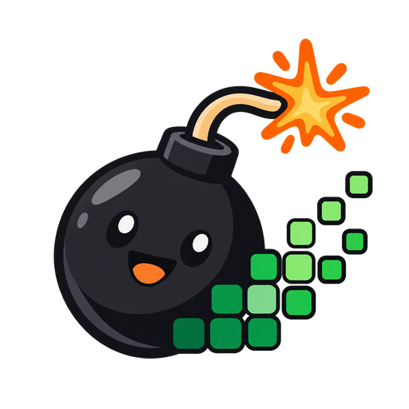

<p align="center">
  
</p>

<h1 align="center">Contriboom</h1>
<p align="center"><strong>Make your contributions a blast.</strong></p>
<p align="center">English · <a href="README.zh-CN.md">简体中文</a></p>

Turn your GitHub contribution calendar into a looping SVG animation.

<p align="center">
  
</p>

This is an animation generator; it does not modify your contributions or provide a playable game.

- Embed animated or static SVGs in your profile README.
- Run daily with GitHub Actions, or generate locally with Node.js.
- Choose full clearing or a preview with a bomb budget, with configurable blast and damage rules.
- Pick a theme and use your own character image.

[Quick start](#quick-start) · [Configuration](#configuration) · [Visual examples](#visual-examples) · [Troubleshooting](#troubleshooting)

## Quick start

### 1. Add the workflow to your profile repository

In your `USERNAME/USERNAME` repository, create `.github/workflows/contriboom.yml`. The following workflow generates the images, commits them to your default branch, and refreshes them daily at **00:23 UTC** (**08:23 Asia/Shanghai**). You can also run it manually from the Actions tab.

```yaml
name: Update contribution animation

on:
  schedule:
    - cron: '23 0 * * *'
  workflow_dispatch:

permissions:
  contents: write

concurrency:
  group: contriboom-profile
  cancel-in-progress: false

jobs:
  generate:
    runs-on: ubuntu-latest
    timeout-minutes: 10
    steps:
      - uses: actions/checkout@v7
        with:
          ref: ${{ github.event.repository.default_branch }}

      - name: Generate contribution arena
        id: contriboom
        uses: ststyin/contriboom@v1.0.0
        with:
          username: ${{ github.repository_owner }}
          github-token: ${{ secrets.GITHUB_TOKEN }}
          output-dir: images/contriboom

      - name: Commit updated images
        shell: bash
        env:
          SVG: ${{ steps.contriboom.outputs.svg }}
          SVG_STATIC: ${{ steps.contriboom.outputs.svg-static }}
        run: |
          git add -f -- "$SVG" "$SVG_STATIC"
          if git diff --cached --quiet; then
            echo "Contribution images are unchanged."
            exit 0
          fi
          git config user.name "github-actions[bot]"
          git config user.email "41898282+github-actions[bot]@users.noreply.github.com"
          git commit -m "Update contribution animation"
          git push
```

The [annotated workflow example](examples/profile.yml) includes every input. Examples use the `v1.0.0` release tag, use `@main` to follow the latest development changes.

### 2. Generate once and embed the image

Run **Update contribution animation** manually and wait for its image commit. Then add this to your profile `README.md`:

```markdown

```

For a static calendar:

```markdown

```

Use the exact directory configured in `output-dir`. These relative links assume the README and generated images are in the same repository and branch.

## Configuration

Configure the Action inside the generation step's `with:` block. Inputs that you omit use the defaults below. Numeric examples are quoted so YAML passes them as strings.

### Data source and output

| Input | Default | Accepted values / behavior |
| --- | --- | --- |
| `username` | `${{ github.repository_owner }}` | The GitHub account to read. |
| `github-token` | `${{ github.token }}` | A token authorized to read that account's contributions. The workflow example passes `${{ secrets.GITHUB_TOKEN }}`. |
| `year` | Empty | Empty: past 365 days, including today. Integer from `2008` through the current UTC year: that calendar year. The current year fetches January 1 through today; future dates are padded with empty cells. |
| `output-dir` | `artifacts` | A subdirectory inside the caller's repository workspace. The example uses `images/contriboom`. |

### Playback

| Input | Default | Accepted values / behavior |
| --- | --- | --- |
| `mode` | `clear` | `clear`: requires a safe full clear, without a bomb count cap. `preview`: limits the number of bombs and can leave blocks uncleared. |
| `max-bombs` | `'5'` | Integer `0–20`. Bomb count limit for `preview`; `0` disables bomb placement. |

`max-bombs` is optional in `preview` mode and defaults to 5. It is an upper limit: fewer bombs may be placed if the calendar is cleared or no safe placement is available. It does not cap a `clear` round. Loop duration is calculated automatically from movement, bombs, and the rebuild sequence; there is no time limit. A full clear can take several minutes on a dense calendar.

### Bomb planning

| Input | Default | Accepted values / behavior |
| --- | --- | --- |
| `planner` | `balanced` | `balanced`, `fewer-bombs`, `fast-clear`, or `min-bombs`. See the goals below. |
| `planner-search-limit` | `'10000'` | Positive safe integer. State budget for `min-bombs`, including its initial state. Other planners do not use this budget. |

| Planner | Goal and guarantees |
| --- | --- |
| `balanced` | Original greedy scoring, balancing hits, approach distance and escape distance. |
| `fewer-bombs` | Bounded lookahead to reduce bombs. Compares the complete plan with `balanced`, choosing fewer bombs, then fewer walking steps. Does not guarantee the global minimum. |
| `fast-clear` | Bounded lookahead to reduce simulated clearing time. Compares complete plans with `balanced` and keeps the faster one, potentially using more bombs than `fewer-bombs`. Does not guarantee the shortest possible time. |
| `min-bombs` | Exact minimum bomb count for the fixed spawn and entry, under the existing movement, blast, damage and serial bomb rules. Requires `mode: clear`. Fails when the state budget prevents proving optimality. |

All planners use the same movement, explosion, safe escape, spawn and automatic entry rules. The minimum-bomb search starts after spawn and entry have been fixed; blocks removed by entry do not use bombs. It does not optimize alternative spawns or entry clearings, or guarantee the shortest walking route among equally small bomb counts.

`min-bombs` is intended for small inputs. Even sparse calendars can exceed the search budget; for a typical full-year calendar, use `fewer-bombs` unless you need an optimality proof. No unproven result is silently returned as `min-bombs`.

`planner-search-limit` counts nodes admitted to the search after pruning, including the initial state. Admitting the same remaining-durability layout again with fewer bombs counts again. It does not limit bomb count, computation seconds or animation duration. A larger value allows more search and can increase time and memory use; it does not ensure that optimality can be proved.

In `preview` mode, `fewer-bombs` and `fast-clear` prioritize hits within the bomb budget, then blocks cleared; with `fade`, each hit removes one durability level. At equal effectiveness, `fast-clear` prefers shorter simulated time. Time includes approach movement, fuse and flame waits; escape movement occurs during the fuse. Planner computation time is separate from animation duration.

```yaml
mode: clear
planner: fewer-bombs
```

For local generation, use `npm run generate -- --fixture demo --planner fast-clear`. For exact search on a small input, use `npm run generate -- --input small-calendar.json --planner min-bombs --planner-search-limit 20000`. The selected planner and budget are recorded in `replay.json`. Omit `planner` to keep the original `balanced` behavior.

For GitHub Actions, use a branch, commit or release whose `action.yml` includes these inputs. Adding inputs to `with:` does not upgrade the revision pinned in `uses:`; when testing a PR, point `uses:` at that PR's branch or commit.

### Explosion rules

| Input | Default | Accepted values / behavior |
| --- | --- | --- |
| `block-damage` | `fade` | `fade`: each hit lowers the activity level by one until the block disappears. `instant`: removes a block on the first hit. |
| `range-mode` | `fixed` | `fixed`, `previous-day`, `previous-week`, or `previous-month`. See the calculation below. |
| `range` | `'4'` | Integer `1–10`, in cells. The blast distance in `fixed` mode; the maximum distance in adaptive modes. |

Adaptive modes calculate one range for the entire replay from the contribution counts in the previous **1**, **7**, or **30** days:

```text
effective range = max(1, min(range, ceil(daily average)))
```

The reference day is excluded. For GitHub data, it is the last day requested from the API; for local JSON, it is the final input date. Missing days count as zero. For example, a 7-day average of `2.3` with `range: '4'` produces a range of `3`; an average of `8` produces `4`.

Explosions travel in four directions, stop at the first contribution block in each direction, and stay inside the calendar. The contribution data itself is preserved; only the animation's block state changes.

### Appearance and randomness

| Input | Default | Accepted values / behavior |
| --- | --- | --- |
| `theme` | `github` | `github`, `light`, `dark`, `ocean`, `sakura`, `cyberpunk`, `sunset`, `nord`, `mocha`, `mint`, `sky`, `lavender`, `peach`, `sand`, `rose`. Recolors the animated and static calendars. |
| `player-icon` | Empty | Empty: built-in robot. Otherwise an image path inside the caller's repository, including nested directories. PNG, JPEG, GIF, WebP, or SVG; maximum **2 MiB**. Embedded into the animated SVG. |
| `player-icon-trim` | `auto` | `auto`: fits the character after trimming transparent or near-white margins. `none`: preserves the full image canvas. Applies to custom icons. |
| `seed` | `'42'` | A JavaScript safe integer. Identical data, generation settings, and seed produce the same replay. Different seeds can change choices between equally good moves. |

Custom characters retain their own artwork and colors. The static calendar does not include a player.

### Action outputs and generated files

| Action output | Value |
| --- | --- |
| `output-dir` | Absolute path to the generated directory. |
| `svg` | Absolute path to `game.svg`. |
| `svg-static` | Absolute path to `game-static.svg`. |

Each run also writes `contributions.json` (the input calendar) and `replay.json` (configuration, events, statistics, and range calculation). The profile workflow commits only the two SVG files.

## Visual examples

These examples use synthetic calendars rendered by Contriboom's actual simulator and SVG renderer. Most use a compact 20-week calendar and `preview` mode so the differences are easy to inspect. Unless a caption says otherwise, comparisons use the same data, `seed: '42'`, `range: '4'`, `block-damage: fade`, and `max-bombs: '5'`. Open an SVG directly to restart its animation.

### Three themes

Change `theme` in `with:`. The same replay is shown in three of the 15 palettes:

<p align="center">
  <strong><code>theme: github</code> (default)</strong><br>
  
</p>

<p align="center">
  <strong><code>theme: dark</code></strong><br>
  
</p>

<p align="center">
  <strong><code>theme: sakura</code></strong><br>
  
</p>

### Full clear and preview

```yaml
# Default: omit mode for full clearing.
mode: preview
max-bombs: '5'
```

<p align="center">
  <strong><code>mode: clear</code> (default)</strong><br>
  
</p>

<p align="center">
  <strong><code>mode: preview</code></strong><br>
  
</p>

The full-clear demo takes about **154 seconds** to remove all 51 blocks; the preview places 5 bombs and loops after **18 seconds**. Both loop durations are calculated automatically.

### Entry on full calendars

If the calendar has no empty cells or no safe first bomb placement, an entry animation temporarily opens a **2 × 2** area before the character appears. Existing safe spawn positions are reused. The entry clears as few contribution blocks as possible, counts them in the clearing statistics, and restores their original levels at the end of the loop. It does not count toward `max-bombs`; ordinary bombs still follow `block-damage`. No extra configuration is needed. Single-column calendars open their entire column because a diagonal escape is unavailable.

<p align="center">
  <strong>Automatic entry on a full calendar (<code>mode: preview</code>, <code>max-bombs: '5'</code>)</strong><br>
  
</p>

### Preview bomb budget

These previews compare `max-bombs` values of `0`, `1`, `5`, and `20`. A larger budget allows more bomb placements and can produce a longer loop; `0` produces a patrol without bombs.

<p align="center">
  <strong><code>max-bombs: '0'</code> (patrol only)</strong><br>
  
</p>

<p align="center">
  <strong><code>max-bombs: '1'</code></strong><br>
  
</p>

<p align="center">
  <strong><code>max-bombs: '5'</code> (default)</strong><br>
  
</p>

<p align="center">
  <strong><code>max-bombs: '20'</code></strong><br>
  
</p>

### Block damage

```yaml
block-damage: instant # Default: fade.
```

<p align="center">
  <strong><code>block-damage: fade</code> (default)</strong><br>
  
</p>

<p align="center">
  <strong><code>block-damage: instant</code></strong><br>
  
</p>

In `fade` mode, a level-4 block needs four hits. `instant` removes it with one hit. Both rebuild the original calendar before the next loop.

### Fixed and adaptive range

```yaml
range-mode: previous-week # Default: fixed.
range: '4'                # Fixed distance or adaptive cap.
```

Fixed distance, 1 cell versus 4 cells:

<p align="center">
  <strong><code>range: '1'</code></strong><br>
  
</p>

<p align="center">
  <strong><code>range: '4'</code> (default)</strong><br>
  
</p>

The same synthetic data produces ranges of 1, 2, and 3 in the adaptive modes below. All use a cap of 4.

<p align="center">
  <strong><code>range-mode: fixed</code> (default; range 4)</strong><br>
  
</p>

<p align="center">
  <strong><code>range-mode: previous-day</code> (range 1)</strong><br>
  
</p>

<p align="center">
  <strong><code>range-mode: previous-week</code> (range 2)</strong><br>
  
</p>

<p align="center">
  <strong><code>range-mode: previous-month</code> (range 3)</strong><br>
  
</p>

### Custom player and icon margins

<p align="center">
  
</p>

To try this character, download [fox-icon.svg](assets/readme/fox-icon.svg), save it as `assets/fox.svg` **in your profile repository**, and configure:

```yaml
player-icon: assets/fox.svg
player-icon-trim: auto # Default; omit this line to keep auto trimming.
```

<p align="center">
  <strong><code>player-icon</code> omitted (default robot)</strong><br>
  
</p>

<p align="center">
  <strong><code>player-icon: assets/fox.svg</code></strong><br>
  
</p>

Set `player-icon-trim: none` to keep deliberate padding. The same padded fox image is used on both sides below; preserving its margins makes the character appear smaller.

<p align="center">
  <strong><code>player-icon-trim: auto</code> (default)</strong><br>
  
</p>

<p align="center">
  <strong><code>player-icon-trim: none</code></strong><br>
  
</p>

### Seeds

```yaml
seed: '66' # Default: 42.
```

<p align="center">
  <strong><code>seed: '42'</code> (default)</strong><br>
  
</p>

<p align="center">
  <strong><code>seed: '66'</code></strong><br>
  
</p>

The input calendar stays the same in this comparison. When using a built-in CLI fixture, `--seed` also controls the generated fixture data.

## Troubleshooting

| Symptom | What to check |
| --- | --- |
| The workflow cannot push its image commit | Workflow write permission and repository rules must allow the bot to push to the target branch. |
| Missing token, access denied, or account not found | Check `username` and token access. GitHub fetch failures are reported; they are not replaced by simulated contributions. |
| Rate limit or network timeout | Retry after the reported limit or connection issue is resolved. The CLI can reuse a valid local cache. |
| Cannot safely clear the calendar | Full calendars get an automatic entry area. A safe path away from every bomb is still required; use `mode: preview` if custom simulation settings prevent a complete clear. |
| `min-bombs search limit ... reached before proving` | Increase `planner-search-limit` or choose `fewer-bombs`. The limit counts admitted search nodes, not seconds or bombs. Generation fails rather than publishing an unproven result. |
| `min-bombs requires mode clear` | Set `mode: clear`, or choose another planner for `preview`. |
| Empty contribution calendar | The robot patrols without inventing contributions. |
| Custom character is too small | Use `player-icon-trim: auto`; use `none` only when you want to retain image padding. |
| README still shows an older image | Check the exact file path and branch, and confirm the workflow pushed the image commit. Browser or GitHub image-proxy caches can delay updates; see [GitHub's cache troubleshooting](https://docs.github.com/en/authentication/keeping-your-account-and-data-secure/about-anonymized-urls). |

## Links

🌐 [Linux Do](https://linux.do)
