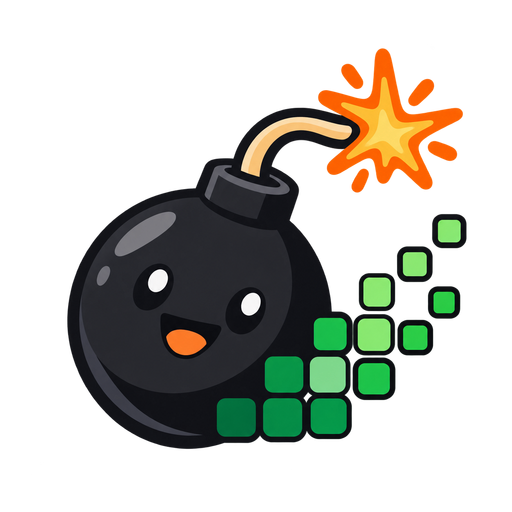

<p align="center">
  
</p>

<h1 align="center">Contriboom</h1>
<p align="center"><strong>Make your contributions a blast.</strong></p>
<p align="center"><a href="README.md">English</a> · 简体中文</p>

将 GitHub 贡献日历变成循环播放的 SVG 动画。

<p align="center">
  
</p>

本项目是动画生成工具，不会修改你的贡献记录，也不是可手动操作的游戏。

- 将动态或静态 SVG 放进个人主页 README。
- 通过 GitHub Actions 每日更新，或使用 Node.js 本地生成。
- 选择完整清场或限制炸弹数量的预览，配置爆炸范围和方块伤害规则。
- 更换主题，使用自己的角色图片。

[快速开始](#快速开始) · [配置参数](#配置参数) · [效果演示](#效果演示) · [常见问题](#常见问题)

## 快速开始

### 1. 在个人主页仓库添加 workflow

在 `用户名/用户名` 仓库中创建 `.github/workflows/contriboom.yml`。下面的 workflow 会生成图片、提交到默认分支，并在每天 **UTC 00:23**（**北京时间 08:23**）更新。也可以在 Actions 页面手动运行。

```yaml
name: Update contribution animation

on:
  schedule:
    - cron: '23 0 * * *'
  workflow_dispatch:

permissions:
  contents: write

concurrency:
  group: contriboom-profile
  cancel-in-progress: false

jobs:
  generate:
    runs-on: ubuntu-latest
    timeout-minutes: 10
    steps:
      - uses: actions/checkout@v7
        with:
          ref: ${{ github.event.repository.default_branch }}

      - name: Generate contribution arena
        id: contriboom
        uses: ststyin/contriboom@main
        with:
          username: ${{ github.repository_owner }}
          github-token: ${{ secrets.GITHUB_TOKEN }}
          output-dir: images/contriboom

      - name: Commit updated images
        shell: bash
        env:
          SVG: ${{ steps.contriboom.outputs.svg }}
          SVG_STATIC: ${{ steps.contriboom.outputs.svg-static }}
        run: |
          git add -f -- "$SVG" "$SVG_STATIC"
          if git diff --cached --quiet; then
            echo "Contribution images are unchanged."
            exit 0
          fi
          git config user.name "github-actions[bot]"
          git config user.email "41898282+github-actions[bot]@users.noreply.github.com"
          git commit -m "Update contribution animation"
          git push
```

[带完整注释的 workflow 示例](examples/profile.yml) 列出了所有参数。如果需要固定版本，可以将 `@main` 替换为你选定的 tag 或提交 SHA。

### 2. 运行一次并引用图片

手动运行 **Update contribution animation**，等待图片提交完成，然后在个人主页的 `README.md` 中加入：

```markdown

```

引用静态日历：

```markdown

```

图片路径必须与 `output-dir` 一致。以上相对路径要求 README 和图片位于同一仓库、同一分支。

## 配置参数

在生成步骤的 `with:` 中填写配置。未填写的参数使用下表中的默认值。数字示例使用引号，使 YAML 将其作为字符串传递。

### 数据来源与输出

| 参数 | 默认值 | 可选值或行为 |
| --- | --- | --- |
| `username` | `${{ github.repository_owner }}` | 要读取贡献数据的 GitHub 用户名。 |
| `github-token` | `${{ github.token }}` | 有权读取该账号贡献数据的访问令牌。workflow 示例使用 `${{ secrets.GITHUB_TOKEN }}`。 |
| `year` | 留空 | 留空：最近 365 天，包含今天。整数 `2008` 至当前 UTC 年份：指定自然年。当前年份读取 1 月 1 日到今天，未来日期补为空格。 |
| `output-dir` | `artifacts` | 调用方仓库工作区内的子目录；示例使用 `images/contriboom`。 |

### 播放模式

| 参数 | 默认值 | 可选值或行为 |
| --- | --- | --- |
| `mode` | `clear` | `clear`：要求安全完整清场，不限制炸弹数量。`preview`：限制炸弹数量，可能留下未清除的方块。 |
| `max-bombs` | `'5'` | 整数 `0–20`。`preview` 模式的炸弹数量上限；`0` 表示不放置炸弹。 |

`preview` 模式可以省略 `max-bombs`，默认值为 5。它是炸弹数量上限，如果已清场或没有安全放置位置，实际数量可能更少；它不限制 `clear` 模式的一轮清场。循环时长根据移动、炸弹和恢复日历的动画自动计算，不设时间上限。贡献密集时，完整清场可能需要数分钟。

### 爆炸规则

| 参数 | 默认值 | 可选值或行为 |
| --- | --- | --- |
| `block-damage` | `fade` | `fade`：每次命中降低一级活跃等级，直到方块消失。`instant`：第一次命中就清除方块。 |
| `range-mode` | `fixed` | `fixed`、`previous-day`、`previous-week`、`previous-month`，计算方法见下文。 |
| `range` | `'4'` | 整数 `1–10`，单位格。固定模式下为实际爆炸距离，自适应模式下为距离上限。 |

自适应模式按前 **1**、**7** 或 **30** 天的贡献次数计算整轮回放统一使用的爆炸范围：

```text
实际范围 = max(1, min(range, ceil(日均贡献次数)))
```

计算不包含参考日期当天。GitHub 数据以 API 查询的最后一天为参考日期，本地 JSON 以最后一条记录的日期为参考日期。缺失日期按零计算。例如，前 7 天日均 `2.3` 次、`range: '4'` 时，实际范围为 `3`；日均 `8` 次时，实际范围为 `4`。

爆炸沿四个方向传播，每个方向遇到第一个贡献方块后停止，不会越出日历边界。动画中的方块状态会变化，原始贡献数据保持不变。

### 外观与随机性

| 参数 | 默认值 | 可选值或行为 |
| --- | --- | --- |
| `theme` | `github` | `github`、`light`、`dark`、`ocean`、`sakura`、`cyberpunk`、`sunset`、`nord`、`mocha`、`mint`、`sky`、`lavender`、`peach`、`sand`、`rose`。同时改变动态和静态日历的配色。 |
| `player-icon` | 留空 | 留空：内置机器人。也可以填写调用方仓库内的图片路径，支持子目录。格式 PNG、JPEG、GIF、WebP、SVG，最大 **2 MiB**；图片嵌入动态 SVG。 |
| `player-icon-trim` | `auto` | `auto`：裁掉透明或近白色留白，使角色适配格子。`none`：保留完整画布。仅用于自定义图片。 |
| `seed` | `'42'` | JavaScript 安全整数。数据、生成配置和种子相同时，生成相同回放。不同种子可能改变同等优先级的行动选择。 |

自定义角色保留原有图案和颜色。静态日历中没有角色。

### Action 输出与生成文件

| Action 输出 | 内容 |
| --- | --- |
| `output-dir` | 生成目录的绝对路径。 |
| `svg` | `game.svg` 的绝对路径。 |
| `svg-static` | `game-static.svg` 的绝对路径。 |

每次运行还会生成 `contributions.json`（输入日历）和 `replay.json`（配置、事件、统计及范围计算结果）。个人主页 workflow 只提交两张 SVG 图片。

## 效果演示

下面的图使用模拟日历，由项目现有的模拟器和 SVG 渲染器生成。大部分使用 20 周的紧凑日历和 `preview` 模式，便于比较。除图片上方说明的参数外，对比使用相同的数据，以及 `seed: '42'`、`range: '4'`、`block-damage: fade`、`max-bombs: '5'`。直接打开 SVG 可以重新开始播放。

### 三种主题

修改 `with:` 中的 `theme` 即可。下面展示 15 种主题中的三种，回放内容相同：

<p align="center">
  <strong><code>theme: github</code>（默认）</strong><br>
  
</p>

<p align="center">
  <strong><code>theme: dark</code></strong><br>
  
</p>

<p align="center">
  <strong><code>theme: sakura</code></strong><br>
  
</p>

### 完整清场与预览

```yaml
# Default: omit mode for full clearing.
mode: preview
max-bombs: '5'
```

<p align="center">
  <strong><code>mode: clear</code>（默认）</strong><br>
  
</p>

<p align="center">
  <strong><code>mode: preview</code></strong><br>
  
</p>

完整清场示例约需 **154 秒**清除全部 51 个方块；预览示例放置 5 枚炸弹，**18 秒**后开始下一轮。两种模式的循环时长均自动计算。

### 全满日历的入场

如果日历没有空格，或无法安全放置第一颗炸弹，会先通过入场动画临时腾出 **2 × 2** 区域，再让角色出现。已有安全出生位时沿用原来的方式。入场会尽量少腾空贡献方块，将其计入清除统计，并在循环结束时恢复原始等级。入场不占用 `max-bombs`，普通炸弹仍遵循 `block-damage`，无需额外配置。单列日历无法提供对角撤离位置，因此会腾出整列。

<p align="center">
  <strong>全满日历自动入场（<code>mode: preview</code>、<code>max-bombs: '5'</code>）</strong><br>
  
</p>

### 预览炸弹上限

下面分别设置 `max-bombs` 为 `0`、`1`、`5`、`20`。上限越大，允许放置的炸弹越多，循环也可能更长；`0` 表示只巡逻、不放炸弹。

<p align="center">
  <strong><code>max-bombs: '0'</code>（只巡逻）</strong><br>
  
</p>

<p align="center">
  <strong><code>max-bombs: '1'</code></strong><br>
  
</p>

<p align="center">
  <strong><code>max-bombs: '5'</code>（默认）</strong><br>
  
</p>

<p align="center">
  <strong><code>max-bombs: '20'</code></strong><br>
  
</p>

### 方块伤害

```yaml
block-damage: instant # Default: fade.
```

<p align="center">
  <strong><code>block-damage: fade</code>（默认）</strong><br>
  
</p>

<p align="center">
  <strong><code>block-damage: instant</code></strong><br>
  
</p>

`fade` 模式下，等级为 4 的方块需要命中四次；`instant` 模式命中一次就消失。两种模式都会在下一轮之前恢复原始日历。

### 固定与自适应范围

```yaml
range-mode: previous-week # Default: fixed.
range: '4'                # Fixed distance or adaptive cap.
```

固定距离 1 格和 4 格的对比：

<p align="center">
  <strong><code>range: '1'</code></strong><br>
  
</p>

<p align="center">
  <strong><code>range: '4'</code>（默认）</strong><br>
  
</p>

下面三种自适应模式根据相同的模拟数据，分别得到 1、2、3 格的实际范围；上限都为 4 格。

<p align="center">
  <strong><code>range-mode: fixed</code>（默认，范围 4）</strong><br>
  
</p>

<p align="center">
  <strong><code>range-mode: previous-day</code>（范围 1）</strong><br>
  
</p>

<p align="center">
  <strong><code>range-mode: previous-week</code>（范围 2）</strong><br>
  
</p>

<p align="center">
  <strong><code>range-mode: previous-month</code>（范围 3）</strong><br>
  
</p>

### 自定义角色与留白

<p align="center">
  
</p>

如果想使用这只狐狸，下载 [fox-icon.svg](assets/readme/fox-icon.svg)，保存到**你自己的个人主页仓库**中，路径为 `assets/fox.svg`，然后配置：

```yaml
player-icon: assets/fox.svg
player-icon-trim: auto # Default; omit this line to keep auto trimming.
```

<p align="center">
  <strong>不填写 <code>player-icon</code>（默认机器人）</strong><br>
  
</p>

<p align="center">
  <strong><code>player-icon: assets/fox.svg</code></strong><br>
  
</p>

如果想保留图片原有留白，设置 `player-icon-trim: none`。下面两侧使用同一张带留白的狐狸图片，保留留白后角色看起来更小。

<p align="center">
  <strong><code>player-icon-trim: auto</code>（默认）</strong><br>
  
</p>

<p align="center">
  <strong><code>player-icon-trim: none</code></strong><br>
  
</p>

### 随机种子

```yaml
seed: '66' # Default: 42.
```

<p align="center">
  <strong><code>seed: '42'</code>（默认）</strong><br>
  
</p>

<p align="center">
  <strong><code>seed: '66'</code></strong><br>
  
</p>

这里保持输入日历不变。使用 CLI 内置示例数据时，`--seed` 也会影响示例数据本身。

## 常见问题

| 现象 | 检查方法 |
| --- | --- |
| workflow 无法推送图片提交 | 工作流写权限和仓库规则需要允许机器人推送到目标分支。 |
| 缺少令牌、访问被拒绝或账号不存在 | 检查 `username` 和令牌权限。GitHub 获取失败会直接报错，不会用模拟数据替代。 |
| API 限流或网络超时 | 等待限流或连接问题解决后重试。CLI 可以复用有效的本地缓存。 |
| 提示无法安全完整清场 | 全满日历会自动创建入场区域，但每次放置炸弹后仍需有安全撤离路径。若自定义模拟配置阻碍完整清场，可使用 `mode: preview`。 |
| 日历没有贡献 | 机器人会巡逻，不会虚构贡献。 |
| 自定义角色过小 | 使用 `player-icon-trim: auto`；只有想保留图片留白时才使用 `none`。 |
| README 仍显示旧图片 | 核对文件路径和分支，确认 workflow 已推送图片提交。浏览器或 GitHub 图片代理缓存可能导致延迟，参见 [GitHub 缓存排查文档](https://docs.github.com/zh/authentication/keeping-your-account-and-data-secure/about-anonymized-urls)。 |
